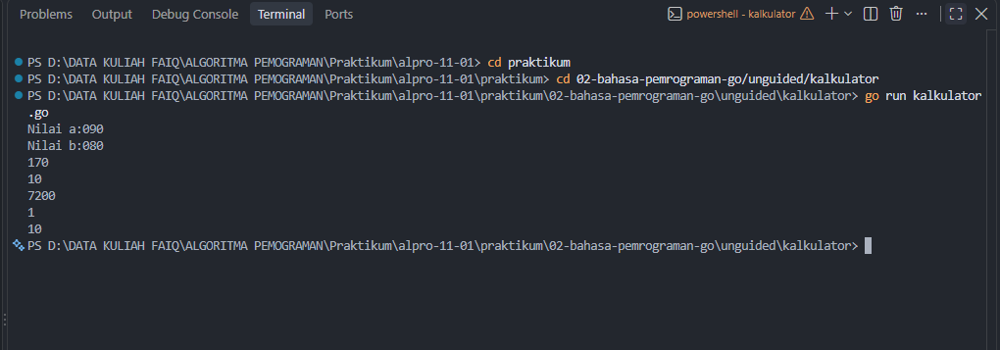
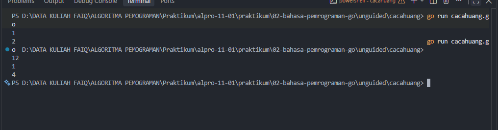

# <h1 align="center">Laporan Praktikum Modul 02 - Operasi Pemograman pada Bahasa Go</h1>
<p align="center">Faiq Fadhlul Aziz - 109092600001</p>

## Dasar Teori

### A.  Bahasa Pemrograman Go
Go atau Golang adalah bahasa pemrograman yang dikembangkan oleh Google. Go dirancang agar memiliki sintaks yang sederhana, mudah dipelajari, serta mendukung pengembangan perangkat lunak yang efisien.

Go merupakan bahasa yang memiliki tipe data statis, sehingga tipe data sebuah variabel ditentukan ketika program dikompilasi. Go juga memiliki fitur seperti garbage collection, concurrency, dan sistem package untuk mengorganisasi kode program.


### B. Struktur Program pada Go

#### 1. Package main dan func main()
Setiap program Go menggunakan package untuk mengorganisasi kode. Program yang dapat dijalankan secara langsung menggunakan `package main`.

Fungsi `main()` merupakan fungsi utama yang akan pertama kali dijalankan ketika program dieksekusi.

#### 2. Import Package
Go menyediakan berbagai package yang dapat digunakan untuk menambahkan fungsi tertentu ke dalam program.

Contohnya adalah package fmt yang digunakan untuk melakukan input dan output.

`import "fmt"` Setelah package diimpor, fungsi yang tersedia di dalam package tersebut dapat digunakan.


## Guided

### 1. Skor.go

```go
package main

import "fmt"

func main() {

	var nama string
	var mtk, bIng int

	fmt.Scan(&nama, &mtk, &bIng)

	total := mtk + bIng
	rataRata := total / 2

	fmt.Println(nama)
	fmt.Println(total)
	fmt.Println(rataRata)
}
```
#### Deskripsi
Menghitung total dan rata-rata nilai dari pelajaran Matematika dan Bahasa Inggris

### 2. Tukar.go

```go
package main

import "fmt"

func main() {
	var a,b int

	//membaca input
	fmt.Scan(&a,&b)

	//menukar nilai a dan b

	a,b = b,a

	//menampilkan Output

	fmt.Println(a)
	fmt.Println(b)
}
```
#### Deskripsi
Menukar nilai variabel a dengan nilai variabel b

## Unguided

### 1. kalkulator.go

```go
package main

import "fmt"

func main() {
	var a, b int

	fmt.Print("Nilai a:", a)
	fmt.Scan(&a)
	fmt.Print("Nilai b:", b)
	fmt.Scan(&b)
		
	
	tambah := a + b
	kurang := a - b
	kali := a * b
	bagi := a / b
	sisa := a % b

	fmt.Println(tambah)
	fmt.Println(kurang)
	fmt.Println(kali)
	fmt.Println(bagi)
	fmt.Println(sisa)
}
```

##### Output
<!-- Path relatif dari readme.md ke folder unguided/[nama_soal]/output.png, contoh: -->



#### Deskripsi
hasil dari tambah, kurang, kali, bagi, dan sisa dari perhitungan nilai variabel a dan variabel b

### 2. cacahuang.go

```go
package main

import "fmt"

func main() {
	var uang int

	uang = 129000

	l10 := uang / 10000
	s10 := uang % 10000

	l5 := s10 / 5000
	s5 := s10 % 5000

	l1 := s5 / 1000

	fmt.Println(l10)

	fmt.Println(l5)

	fmt.Println(l1)


}

```

##### Output


#### Deskripsi
Mencari jumlah lembar uang mulai dari 1rb, 5rb, dan 10rb dari jumlah uang yang ada di variabel uang

<!-- Duplikasi blok "### [nama_soal]" sesuai jumlah folder soal di dalam unguided -->


## Kesimpulan
Berdasarkan praktikum yang telah dilakukan, dapat disimpulkan bahwa bahasa pemrograman Go memiliki struktur program yang sederhana dan terorganisasi menggunakan package. Melalui praktikum ini, konsep dasar seperti package main, fungsi main(), import package, variabel, dan tipe data dapat dipahami dan diterapkan dalam program sederhana.

## Referensi
1. Google. ([2026]). *[The Go Programming Language Documentation]*. [Mountain View]: [Google]. Diakses pada [27 september 2026] melalui [[tautan/DOI](https://go.dev/doc/)]
2. [Donovan, A. A. A., & Kernighan, B. W.]. ([2015]). *[The Go Programming Language]*. [Boston]: [Donovan, A. A. A., & Kernighan, B. W.]. Diakses pada [27 september 2026] melalui [[tautan/DOI](https://www.gopl.io/)]
<!-- Tambahkan nomor referensi berikutnya sesuai kebutuhan -->
