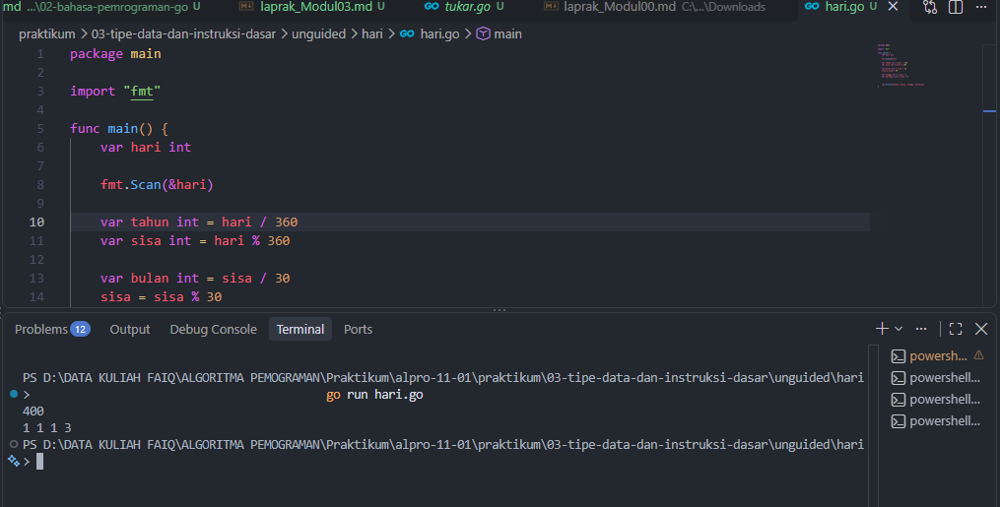
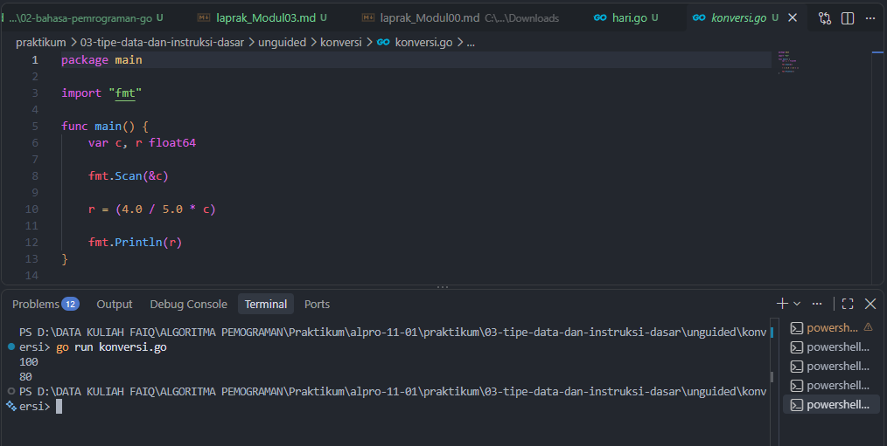

# <h1 align="center">Laporan Praktikum Modul 03 - Variabel dan Operator</h1>
<p align="center">Faiq Fadhlul Aziz - 109092600001</p>

## Dasar Teori

### A.  Variabel dan Tipe Data pada Bahasa Go

Variabel merupakan tempat untuk menyimpan nilai yang dapat digunakan dan diolah selama program dijalankan. Dalam bahasa Go, setiap variabel memiliki tipe data tertentu yang menentukan jenis nilai yang dapat disimpan. Beberapa tipe data yang digunakan dalam praktikum ini adalah `int` untuk bilangan bulat dan `float64` untuk bilangan desimal.

Variabel dapat dideklarasikan menggunakan kata kunci `var`, contohnya:

```go
var x int
var c float64
```


### B. Operator pada Bahasa Go

Operator merupakan simbol yang digunakan untuk melakukan operasi terhadap suatu nilai atau variabel. Dalam bahasa Go terdapat beberapa jenis operator, salah satunya adalah operator aritmatika yang digunakan untuk melakukan perhitungan.

Operator aritmatika yang umum digunakan antara lain + untuk penjumlahan, - untuk pengurangan, * untuk perkalian, / untuk pembagian, dan % untuk mendapatkan sisa hasil pembagian atau modulus.


## Guided

### 1. cacah.go

```go
package main

import "fmt"

func main() {
	var x int
	fmt.Scan(&x)

	var sepuluh int = x / 10000
	var sisa int = x % 10000

	var lima int = sisa / 5000
	sisa = sisa % 5000

	var satu int = sisa / 1000

	fmt.Println(sepuluh, lima, satu)
}

```
#### Deskripsi
Menghitung jumlah lembar uang 10rb, 5rb dan 1rb dari jumlah uang yang diinput

### 2. konversi.go

```go
package main

import "fmt"

func main() {
	var c, k float64

	fmt.Scan(&c)
	k = (c + 273)
	fmt.Println(k)
}

```
#### Deskripsi
Mengkonversi nilai dari celcius ke kelvin

### 2. tukar.go

```go
package main

import (
	"fmt" 

)

func main() {
	var x, y, z  int

	fmt.Scan(&x, &y, &z)

	temp := x
	x = z
	z = y
	y = temp

	fmt.Println(x, y, z)
}

```
#### Deskripsi
Menukar isi nilai dari variabel


## Unguided

### 1. hari.go

```go
package main

import "fmt"

func main() {
	var hari int

	fmt.Scan(&hari)

	var tahun int = hari / 360
	var sisa int = hari % 360

	var bulan int = sisa / 30
	sisa = sisa % 30

	var minggu int = sisa / 7
	var hariSisa int = sisa % 7


	fmt.Println(tahun, bulan, minggu, hariSisa)
}
```

##### Output
<!-- Path relatif dari readme.md ke folder unguided/[nama_soal]/output.png, contoh: -->



#### Deskripsi
Menghitung sisa tahun, bulan, minggu dan hari dari jumlah hari yang diinput

### 2. konversi.go

```go
package main

import "fmt"

func main() {
	var c, r float64

	fmt.Scan(&c)

	r = (4.0 / 5.0 * c)

	fmt.Println(r)
}
```

##### Output


#### Deskripsi
Mengkonversi celcius ke Reamur
<!-- Duplikasi blok "### [nama_soal]" sesuai jumlah folder soal di dalam unguided -->


## Kesimpulan
Berdasarkan praktikum yang telah dilakukan, dapat disimpulkan bahwa bahasa pemrograman Go memiliki struktur program yang sederhana dan terorganisasi menggunakan package. Melalui praktikum ini, konsep dasar seperti package main, fungsi main(), import package, variabel, dan tipe data dapat dipahami dan diterapkan dalam program sederhana.

## Referensi
1. Google. ([2026]). *[The Go Programming Language Documentation]*. [Mountain View]: [Google]. Diakses pada [27 september 2026] melalui [[tautan/DOI](https://go.dev/doc/)]
2. [Donovan, A. A. A., & Kernighan, B. W.]. ([2015]). *[The Go Programming Language]*. [Boston]: [Donovan, A. A. A., & Kernighan, B. W.]. Diakses pada [27 september 2026] melalui [[tautan/DOI](https://www.gopl.io/)]
<!-- Tambahkan nomor referensi berikutnya sesuai kebutuhan -->
