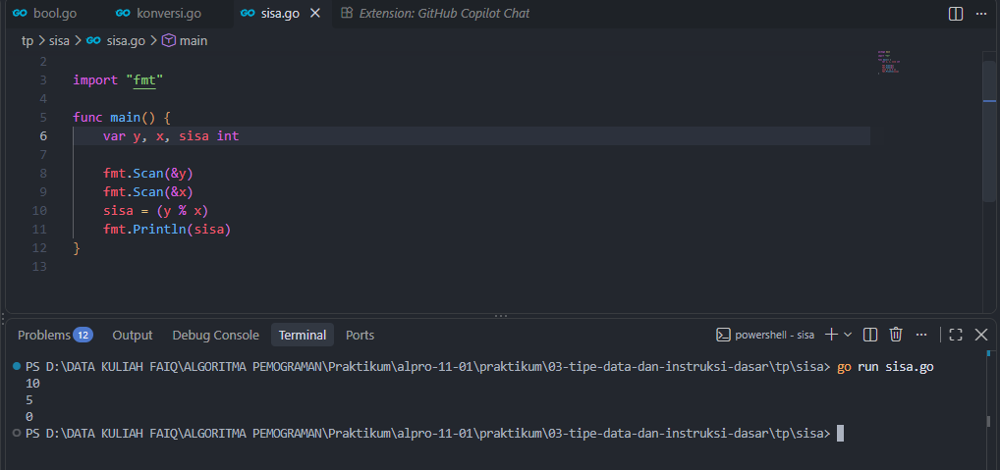
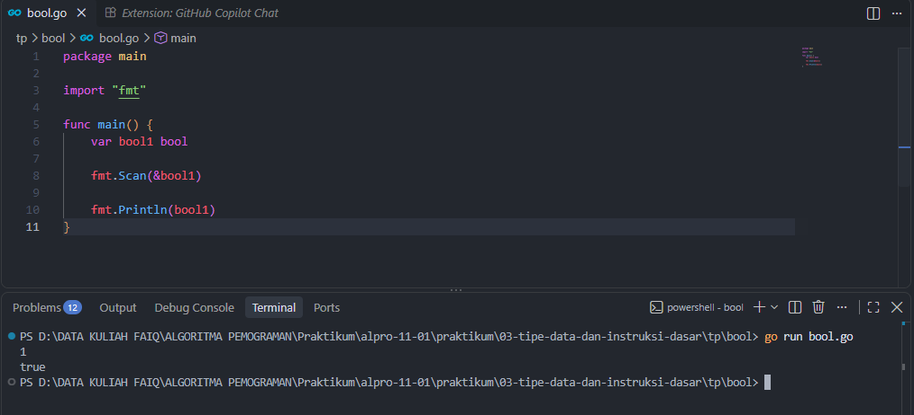
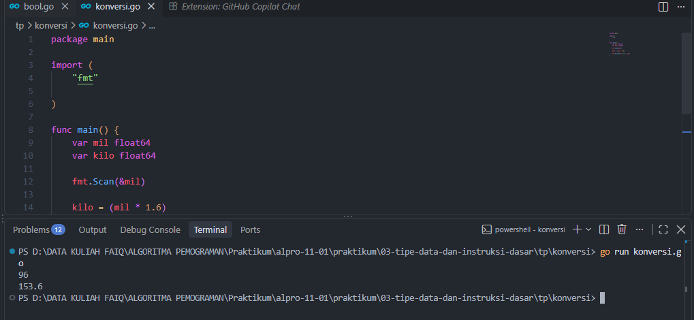

# <h1 align="center">Tugas Pendahuluan Modul 03 - Variabel dan Operator</h1>
<p align="center">Faiq Fadhlul Aziz - 109092600001</p>

### 1. sisa.go

```go
package main

import "fmt"

func main() {
	var y, x, sisa int

	fmt.Scan(&y)
	fmt.Scan(&x)
	sisa = (y % x)
	fmt.Println(sisa)
}

```

##### Output
<!-- Path relatif dari readme.md ke folder unguided/[nama_soal]/output.png, contoh: -->



#### Deskripsi
Menghitung sisa dari variabel y dan x

### 2. bool.go

```go
package main

import "fmt"

func main() {
	var bool1 bool

	fmt.Scan(&bool1)
	
	fmt.Println(bool1)
}
```

##### Output
<!-- Path relatif dari readme.md ke folder unguided/[nama_soal]/output.png, contoh: -->



#### Deskripsi
Mendeteksi nilai yang dimasukkan, misal input True/1 outputnya true, jika input false/0 outputnya false

### 2. konversi.go

```go
package main

import (
	"fmt"

)

func main() {
	var mil float64
	var kilo float64

	fmt.Scan(&mil)

	kilo = (mil * 1.6)

	fmt.Printf("%.1f\n", kilo)
}

```

##### Output
<!-- Path relatif dari readme.md ke folder unguided/[nama_soal]/output.png, contoh: -->



#### Deskripsi
Menkoversi nilai mil menjadi kilometer

## Kesimpulan
melatih dasar pemakaian operator aritmatika