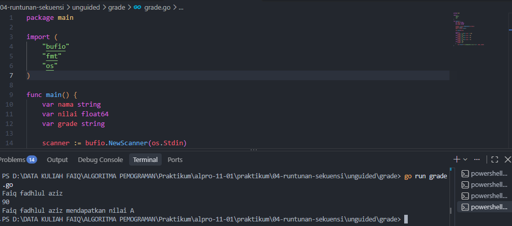
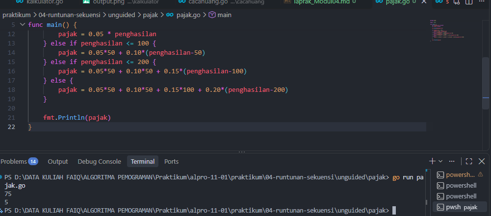

# <h1 align="center">Laporan Praktikum Modul 04 - RUNTUNAN/SEKUENSI”</h1>
<p align="center">Faiq Fadhlul Aziz - 109092600001</p>

## Dasar Teori

## A. Operator Perbandingan dan Logika di Go
1. Operator Perbandingan
Operator seperti >, <, >=, <=, ==, dan != membandingkan dua nilai dan menghasilkan boolean (true atau false). Hasilnya dipakai sebagai kondisi pada percabangan.

2. Operator Logika
Operator && (AND) bernilai true jika kedua sisi benar, || (OR) jika salah satu sisi benar, dan ! (NOT) membalik nilai boolean. Urutan evaluasinya: ! lebih dulu, lalu &&, kemudian ||.

## B. Percabangan
1. If - Else If - Else
Percabangan ini menjalankan blok kode sesuai kondisi yang terpenuhi. Pengecekan dilakukan dari atas ke bawah dan berhenti pada kondisi pertama yang benar.

2. Switch Case
Switch adalah alternatif if - else if yang lebih rapi untuk banyak kondisi. Di Go, switch bisa ditulis tanpa ekspresi dan langsung keluar setelah satu case cocok, sehingga tidak perlu break.


## Guided

### 1. grade.go

```go
package main

import (
	"fmt"
	"bufio"
	"os"
)

func main() {
	var nama string
	var nilai float64
	var grade string

	scanner := bufio.NewScanner(os.Stdin)
	scanner.Scan()
	nama = scanner.Text()

	fmt.Scan(&nilai)

	if nilai >= 90 && nilai <= 100 {
		grade = "A"
	} else if nilai >= 80 && nilai < 90 {
		grade = "B"
	} else if nilai >= 70 && nilai < 80 {
		grade = "C"
	} else if nilai >= 60 && nilai < 70 {
		grade = "D"
	} else {
		grade = "E"
	}

	fmt.Printf("%s mendapatkan nilai %s\n", nama, grade)
}

```
#### Deskripsi
Mengklasifikasikan tingkat berdasarkan nilai

### 2. klasifikasi.go

```go
package main

import (
	"fmt" 
)

func main() {

	var usia int
	var gaji int
	var keterangan string

	fmt.Scan(&usia)
	fmt.Scan(&gaji)

	switch {
	case usia < 18:
		keterangan = "Masih sekolah"
	case usia >= 18 && usia <= 25 && gaji >= 50:
		keterangan = "Muda sukses"
	case usia >= 18 && usia <= 25 && gaji < 50:
		keterangan = "Masih belajar hidup"
	case usia >= 26 && usia <= 40 && gaji >= 100:
		keterangan = "Pekerja mapan"
	case usia >= 26 && usia <= 40 && gaji < 100:
		keterangan = "Perlu perbaikan karier"
	case usia > 40 && gaji >= 150:
		keterangan = "Profesional berpengalaman"
	case usia > 40 && gaji < 150:
		keterangan = "Perlu evaluasi finansial"
	}

	fmt.Println(keterangan)
}
```
#### Deskripsi
Mengklasifikasi tingkat kemapamanan melalui umur dan gaji

### 2. penilaian.go

```go
package main

import (
	"bufio"
	"fmt"
	"os"
)

func main() {
	var pilihan int
	var nama string
	var nilai float64
	var grade string

	fmt.Println("============= Menu =============")
	fmt.Println("1. Sistem penilaian")
	fmt.Println("0. Keluar")
	fmt.Print("Pilih opsi: ")

	fmt.Scanln(&pilihan)

	if pilihan == 1 {
		fmt.Print("Masukkan nama siswa: ")

		scanner := bufio.NewScanner(os.Stdin)

	
		scanner.Scan()


		nama = scanner.Text()

		fmt.Print("Masukkan nilai siswa: ")
		fmt.Scanln(&nilai)

		if nilai >= 90 && nilai <= 100 {
			grade = "A"
		} else if nilai >= 80 && nilai < 90 {
			grade = "B"
		} else if nilai >= 70 && nilai < 80 {
			grade = "C"
		} else if nilai >= 60 && nilai < 70 {
			grade = "D"
		} else {
			grade = "F"
		}

		fmt.Printf("%s mendapatkan nilai %s\n", nama, grade)

	} else if pilihan == 0 {
		fmt.Println("Keluar dari program.")

	} else {
		fmt.Println("Pilihan tidak valid.")
	}
}
```
#### Deskripsi
Mengklasifikasikan tingkat berdasarkan nilai


## Unguided

### 1. grade.go

```go
package main

import (
	"bufio"
	"fmt"
	"os"
)

func main() {
	var nama string
	var nilai float64
	var grade string

	scanner := bufio.NewScanner(os.Stdin)
	scanner.Scan()
	nama = scanner.Text()

	fmt.Scan(&nilai)

	switch {
	case nilai >= 90 && nilai <= 100:
		grade = "A"
	case nilai >= 80 && nilai < 90:
		grade = "B"
	case nilai >= 70 && nilai < 80:
		grade = "C"
	case nilai >= 60 && nilai < 70:
		grade = "D"
	case nilai < 60:
		grade = "E"
	}
		fmt.Printf("%s mendapatkan nilai %s\n", nama, grade)
}

```

##### Output
<!-- Path relatif dari readme.md ke folder unguided/[nama_soal]/output.png, contoh: -->



#### Deskripsi
Program ini sama seperti di grade.go, bedanya disini memakai switch-case.

### 2. konversi.go

```go
package main

import "fmt"

func main() {
	var penghasilan float64
	var pajak float64

	fmt.Scan(&penghasilan)

	if penghasilan <= 50 {
		pajak = 0.05 * penghasilan
	} else if penghasilan <= 100 {
		pajak = 0.05*50 + 0.10*(penghasilan-50)
	} else if penghasilan <= 200 {
		pajak = 0.05*50 + 0.10*50 + 0.15*(penghasilan-100)
	} else {
		pajak = 0.05*50 + 0.10*50 + 0.15*100 + 0.20*(penghasilan-200)
	}

	fmt.Println(pajak)
}
```

##### Output


#### Deskripsi
Program ini untuk menghitung pajak sesuai penghasilan
<!-- Duplikasi blok "### [nama_soal]" sesuai jumlah folder soal di dalam unguided -->


## Kesimpulan
Praktikum ini melatih pembuatan program yang memilih alur berdasarkan kondisi. If - else if cocok untuk kondisi bertingkat seperti pajak, sedangkan switch membuat pengelompokan seperti nilai huruf lebih rapi.

## Referensi
1. Google. ([2026]). *[The Go Programming Language Documentation]*. [Mountain View]: [Google]. Diakses pada [27 september 2026] melalui [[tautan/DOI](https://go.dev/doc/)]
2. [Donovan, A. A. A., & Kernighan, B. W.]. ([2015]). *[The Go Programming Language]*. [Boston]: [Donovan, A. A. A., & Kernighan, B. W.]. Diakses pada [27 september 2026] melalui [[tautan/DOI](https://www.gopl.io/)]
<!-- Tambahkan nomor referensi berikutnya sesuai kebutuhan -->
